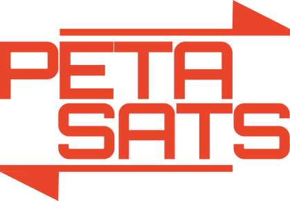

<p align="center"></p>

# PetaSats MCP

Buy BSV with USDC on Base from your AI app through a local, non-custodial MCP server.

## What it does

PetaSats supports USDC on Base to BSV only. Keys are made and kept on your machine.

1. You lock USDC in the swap contract on Base.
2. The market maker locks BSV.
3. The kit verifies the lock against a merkle proof and block headers, then claims BSV and reveals the secret.
4. The market maker uses that secret to claim USDC.

Swaps are about $5 to $100. Each buyer may make three swaps and $200 per day; a shared daily total also applies. They usually take 15 to 25 minutes.

## Install and connect

Use Node.js 22 or newer. Pinning `petasats-mcp@0.2.1` is recommended.

```sh
claude mcp add petasats -- npx -y petasats-mcp
```

Claude Desktop (`claude_desktop_config.json`), Cursor (`~/.cursor/mcp.json`):

```json
{"mcpServers":{"petasats":{"command":"npx","args":["-y","petasats-mcp"]}}}
```

VS Code (`.vscode/mcp.json`):

```json
{"servers":{"petasats":{"type":"stdio","command":"npx","args":["-y","petasats-mcp"]}}}
```

Codex (CLI, IDE extension, or app):

```sh
codex mcp add petasats -- npx -y petasats-mcp
```

Any client that starts local stdio servers can use command `npx` and args `-y petasats-mcp`. First start creates keys in `~/.petasats`; `PETASATS_HOME` changes that location. Back up `keys.json`: it is the only copy.

## Fund the kit

`wallet_info` shows the Base address. Send it USDC on Base and a little ETH for gas; 0.0002 ETH covers many swaps.

## Use it

Ask: “Buy $20 of BSV and send it to 1...”

| Tool | Moves funds |
| --- | --- |
| get_quote | No |
| swap_asset_to_bsv | Yes |
| wait_for_swap | No |
| swap_status | No |
| wallet_info | No |
| withdraw_bsv | Yes |
| withdraw_base | Yes |
| fund_wallet | Yes |
| list_liquidity | No |

## Progress and reporting

The server gives the AI an operating guide. With a person watching, it reports one line per stage and a final summary with transaction IDs. For a program it returns only the result. Reporting never holds up a swap, and nothing asks for confirmation after a swap starts.

## Safety model

Funds can go only to the swap contract on Base, the kit’s own addresses, or an address you provide. The kit verifies before reveal. The market maker’s BSV can return about four hours (24 blocks) after lock; your USDC refunds after about 16 hours if the swap does not finish. Recovery resumes after restart. Run one swap at a time and keep the server running during a swap.

## Costs

`get_quote` shows the rate and comparison with market mid. You pay Base gas in ETH, the BSV claim fee, and a small extra BSV fee with `deliver_to`. See `get_quote` for protocol fees.

## Verify what you run

The npm package is built by GitHub Actions from a tagged commit and published with npm provenance. Run `npm audit signatures`; the npm page links the build to its commit and workflow run. `dist/petasats-mcp.mjs` is not minified. Source under `src/` is exported from the development repository for each release with internal development comments removed and internal names replaced by neutral ones; apart from that it is identical.

## Files, status, and recovery

The kit uses `~/.petasats`. Run `npx petasats-mcp status` for status and `npx petasats-mcp recover` after interruption.

## Troubleshooting

`busy`, `limit`, `rate_limited`, `unavailable`, and `declined` mean nothing was locked. If keys-file permissions are wrong, restore owner-only access. For RPC trouble, check your network connection and retry.

## Security, license, and disclaimer

See [SECURITY.md](SECURITY.md). PetaSats uses the Open BSV License v4; third-party notices are in `THIRD_PARTY_NOTICES.md`. This is experimental software: use small amounts and there is no warranty.
