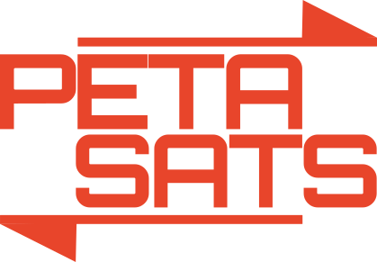

<p align="center"></p>

# PetaSats MCP

[](https://glama.ai/mcp/servers/BSVanon/petasats-mcp)

Buy BSV with USDC on Base from your AI app through a local, non-custodial MCP server.

## What it does

PetaSats supports USDC on Base to BSV only. Keys are made and kept on your machine.

1. You lock USDC in the swap contract on Base.
2. The counterparty locks BSV.
3. The kit verifies the lock against a merkle proof and block headers, then claims BSV and reveals the secret.
4. The counterparty uses that secret to claim USDC.

Swaps are about $5 to $100. Each buyer may make three swaps and $200 per day; a shared daily total also applies. Standard speed is the default and waits for one BSV confirmation. An explicit `speed: "fast"` request can reduce that wait for at most $25 only when both sides agree.

## Install and connect

Use Node.js 22 or newer. Every command here runs this release, `petasats-mcp@0.2.22`. Use one version in your client's entry and in terminal commands; to move to a later release, change it while no swap is running and restart the client.

```sh
claude mcp add petasats -- npx -y petasats-mcp@0.2.22
```

Claude Desktop (`claude_desktop_config.json`), Cursor (`~/.cursor/mcp.json`):

```json
{"mcpServers":{"petasats":{"command":"npx","args":["-y","petasats-mcp@0.2.22"]}}}
```

VS Code (`.vscode/mcp.json`):

```json
{"servers":{"petasats":{"type":"stdio","command":"npx","args":["-y","petasats-mcp@0.2.22"]}}}
```

Codex (CLI, IDE extension, or app):

```sh
codex mcp add petasats -- npx -y petasats-mcp@0.2.22
```

Any client that starts local stdio servers can use command `npx` and args `-y petasats-mcp@0.2.22`. First start creates keys in `~/.petasats`; `PETASATS_HOME` changes that location. Back up `keys.json`: it is the only copy. Run only one copy of a kit home, because two copies of the same keys can each sign Base payments the other cannot see.

## Fund the kit

`wallet_info` shows the Base address. Send it USDC on Base and a little ETH for gas; 0.0002 ETH covers many swaps.

## Use it

Ask: “Buy $20 of BSV and send it to 1...”

| Tool | Moves funds |
| --- | --- |
| get_quote | No |
| swap_asset_to_bsv | Yes |
| wait_for_swap | No |
| swap_status | No |
| wallet_info | No |
| stop_spending | No |
| withdraw_bsv | Yes |
| withdraw_base | Yes |
| fund_wallet | No — it only plans a USDC-to-BSV swap and returns a quote |
| list_liquidity | No |

## Limits you control

You can create `~/.petasats/limits.json` to restrict where an AI may send funds and how much it may swap per UTC day:

```json
{
  "format": "petasats.limits/1",
  "bsvDestinations": ["1BoatSLRHtKNngkdXEeobR76b53LETtpyT"],
  "baseDestinations": ["0x1111111111111111111111111111111111111111"],
  "maxSwapUsdPerDay": 50,
  "allowFastSettlement": false
}
```

Keep this file private to your user account: `chmod 600 ~/.petasats/limits.json`. The kit refuses a limits file that other users can read or write. It rereads the file before every money operation. A refusal says that it was refused by your limits file and that nothing was sent. Use `npx petasats-mcp@0.2.22 limits` to inspect it.

`stop_spending` stops new swaps and withdrawals immediately. Only you can resume with `npx petasats-mcp@0.2.22 resume`; recovery for swaps already started keeps working.

`allowFastSettlement: false` forbids fast settlement for new swaps. If the field is missing, an explicitly requested fast swap is permitted to negotiate it; standard remains the default.

These controls protect against an AI that can only use the kit's tools. An AI app that can run shell commands or edit files as you can also edit `limits.json` or `STOP`.

## Progress and reporting

The server gives the AI an operating guide. With a person watching, it reports one line per stage and a final summary with transaction IDs. For a program it returns only the result. Reporting never holds up a swap, and nothing asks for confirmation after a swap starts.

## Trust model

The kit runs on your machine. Its keys are made and kept there, and PetaSats never holds your coins. Funds can go only to the swap contract on Base, the kit's own addresses, or an address you provide.

The counterparty quotes a price, can decline or delay a swap, and locks BSV for you. It cannot take your USDC without the swap secret, and the kit reveals that secret only by claiming your BSV. If the counterparty never locks BSV, your USDC refunds to you once the Base lock expires, about 10 hours (180,000 Base blocks) after you lock it. The counterparty's BSV lock can return to it after at most 12 BSV blocks (about 2 hours), so the kit claims well before then.

A swap has a competing transaction by design: the counterparty's BSV refund becomes valid at a fixed block height. So standard settlement waits until the counterparty's BSV lock is in a block and checked against a merkle proof and block headers before the kit reveals the secret, and after it claims, the kit watches its claim until that is in a block too. The standard Base gate is 60 confirmations (about 12 seconds). Fast mode reveals against an unconfirmed BSV lock, and if the counterparty double-spends that lock you can lose the swap amount. It runs only when you request `speed: "fast"`, both sides agree, and the amount is within the quote's fast cap: at most $25, and the kit refuses any cap above $35.

You trust the npm package you run (see Verify what you run), the Base RPC and BSV data services the kit reads, and the BSV network's first-seen rule while a transaction is unconfirmed. Recovery resumes after a restart. Run one swap at a time, and keep the server running during a swap.

## Costs

`get_quote` shows the rate and comparison with market mid. You pay Base gas in ETH, the BSV claim fee, and a small extra BSV fee with `deliver_to`. See `get_quote` for protocol fees.

## Verify what you run

The npm package is built by GitHub Actions from a tagged commit and published with npm provenance. Run `npm audit signatures`; the npm page links the build to its commit and workflow run. `dist/petasats-mcp.mjs` is not minified. Source under `src/` is exported from the development repository for each release with internal development comments removed and internal names replaced by neutral ones; apart from that it is identical.

## Files, status, and recovery

The kit uses `~/.petasats`. Run `npx petasats-mcp@0.2.22 status` for status and `npx petasats-mcp@0.2.22 recover` after interruption.

A Base withdrawal left pending (for example after a fee rise) is re-sent unchanged; new swaps and Base withdrawals wait until it confirms. Run `npx petasats-mcp@0.2.22 withdrawals` to list pending withdrawals. If a finalized nonce was consumed but its receipt cannot be found, check the transaction in a Base explorer, then explicitly record the outcome with `npx petasats-mcp@0.2.22 withdrawal <hash> sent` or `npx petasats-mcp@0.2.22 withdrawal <hash> not-sent`.

Repeating the same Base withdrawal (same asset, amount, and address) within an hour is refused as a likely retry. Do not run two AI apps using the kit on the same folder at the same time.

A swap started with version 0.2.0 or 0.2.1 whose USDC lock never landed can stay at "Waiting for BSV lock" and block new swaps and withdrawals. If no other copy of the kit used the same folder while that swap ran, set `PETASATS_RESOLVE_OLD_STUCK_SWAPS=1` in the kit's environment (for example `"env":{"PETASATS_RESOLVE_OLD_STUCK_SWAPS":"1"}` in your client's server entry) and restart the kit. It then sends a zero-value transaction to its own Base address so the old lock can never land, and marks the swap failed once that transaction is final, usually within 30 minutes. Swaps started with 0.2.2 or later resolve without this setting.

## Troubleshooting

`busy`, `limit`, `rate_limited`, `unavailable`, and `declined` mean nothing was locked. If keys-file permissions are wrong, restore owner-only access. For RPC trouble, check your network connection and retry.

## Release notes

0.2.22:

- The kit is now released under the MIT License.
- A copy of the kit running on a shared server, such as an MCP directory's "Try in Browser", gives quotes only. It refuses every tool that touches keys or money and says to run the kit on your own machine. Set `PETASATS_QUOTE_ONLY=1` to get the same behaviour anywhere.
- The server answers `resources/templates/list` with an empty list, so MCP inspectors no longer log an error.

0.2.21:

- The kit no longer shows "claiming" after your BSV has arrived when BSV block headers lag behind.
- Before delivering to your address, the kit checks every payout it relays: the transaction and its proof agree, it spends only the claim, and the amount, address and fee are right.
- Base data-source checks are bounded at 120 seconds and use fixed reference blocks, so a slow or unusual Base RPC can't stall the kit.
- All text now calls the other side "the counterparty."
- A Trust model section explains the current 10-hour USDC lock and 12-block BSV window.

0.2.19:

- Fixes 0.2.18, which could not complete a swap. It cancelled each network request just after it succeeded, before reading the reply, so every BSV height, block-header and proof read failed with the error "The operation was aborted." Every swap was therefore refused before anything was locked, with a reason that includes "only 0/2 independent source(s)". Do not use 0.2.18.
- The kit now reads BSV block heights and headers from three independent sources: Anvil, WhatsOnChain and Project Babbage’s public chaintracks service. Two must agree on a height, and on the header behind a proof. A new swap starts only when two sources are within 3 blocks of the highest height. If a source that is more than 2 blocks past a block reports a different header for it, the proof check fails, however many other sources agree. If one of the three is down, new swaps and proof checks still go ahead. A source that has no header for that block counts as down.

0.2.18:

- Before it reveals its secret, the kit now checks two things: the counterparty’s BSV lock is the only one that qualifies, and your USDC is still locked on Base far enough ahead of its refund time to leave the counterparty time to claim it. Until both hold, it keeps waiting, up to a limit. If they cannot hold, it stops without revealing, and your USDC comes back through the refund.
- A swap whose Base side has already finished, by a finalized claim or refund (including the counterparty’s cooperative refund), now ends and closes its record instead of waiting.
- When the counterparty is briefly busy, its decline now says when to try again. If the wait is short, the kit waits and asks again by itself, after checking that its quote is still valid. Nothing is locked before that.

0.2.17:

- If the counterparty backs out after your USDC is locked and before it locks any BSV, it now returns your USDC early with a cooperative refund. The kit recognises that refund once Base finalizes it and reports the swap as refunded, instead of waiting for the timeout.
- If the counterparty’s BSV lock arrives late, the kit keeps listening for it while it can still be claimed safely, instead of giving up early.
- Shorter windows: the counterparty’s BSV can return about two hours (12 blocks) after lock, and your USDC refunds after about 10 hours (it was about 16) if the swap does not finish.

## Security, license, and disclaimer

See [SECURITY.md](SECURITY.md). PetaSats is released under the MIT License; third-party notices are in `THIRD_PARTY_NOTICES.md`. This is experimental software: use small amounts and there is no warranty.
